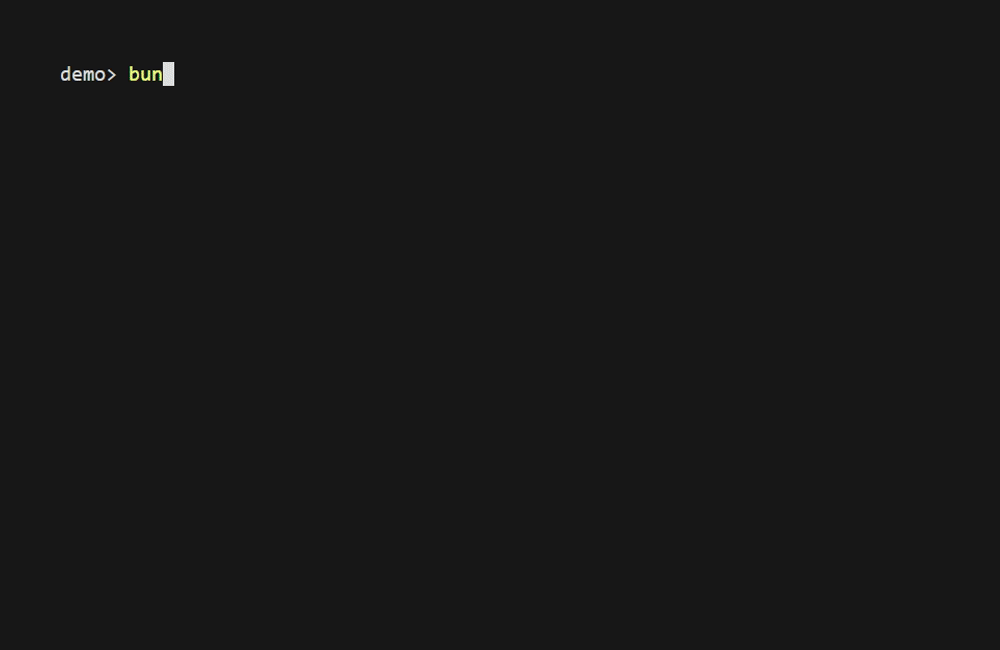

# create-chrome-extension

An interactive TypeScript script for scaffolding a Chrome extension. It prompts for extension metadata, permissions, scripts, popup technology, and optional build dependencies, then writes a folder named after the extension in the current directory.

## Terminal demo



Recorded with [VHS](https://github.com/charmbracelet/vhs). [Recording source and instructions](docs/demo/README.md).

## Run from source

The repo contains `index.ts` and no package manifest or published CLI setup. Use Bun to run the TypeScript source directly:

```bash
git clone https://github.com/SpyC0der77/create-chrome-extension.git
cd create-chrome-extension
bun add @clack/prompts chalk
bun run index.ts
```

The dependency installation creates local package files. Run the script in the directory where you want the generated extension folder. It refuses to overwrite an existing folder with the same name.

## Generated files

- `manifest.json` with the selected metadata and permissions.
- Optional background and content scripts in JavaScript or TypeScript.
- Optional popup in plain HTML/JavaScript, TypeScript, or React TSX.
- Optional options page and Manifest V2 DevTools page.
- An optional `src/` folder and `package.json` with selected build dependencies.
- `TODO.md` with the remaining implementation and build steps.

## Finish the extension

Choose Manifest V3 for new Chrome extensions. The script still offers a legacy Manifest V2 option. Generated TypeScript and TSX must be compiled or bundled to JavaScript, and referenced icon files must be provided separately. Selecting a bundler adds dependencies; it does not generate a complete bundler configuration.

After completing those steps, open `chrome://extensions`, enable Developer mode, choose **Load unpacked**, and select the generated folder containing `manifest.json`.

## License

[MIT](LICENSE).
